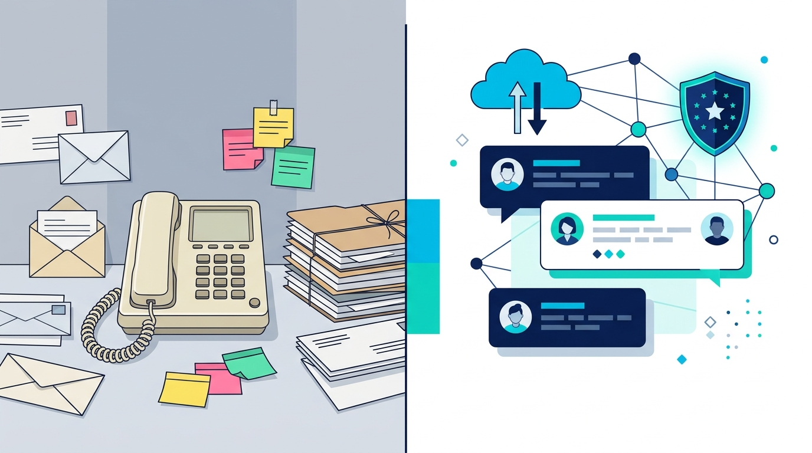
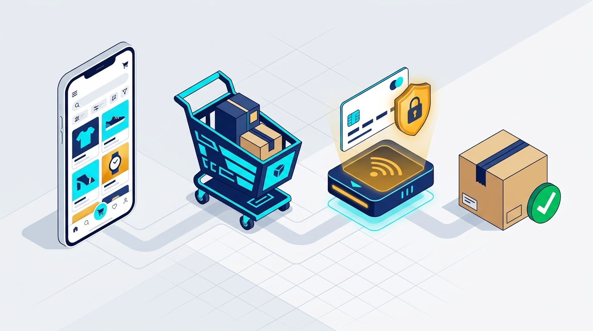

<!-- _class: cover -->
<!-- _paginate: false -->

Unit 6 • Thuyết trình nhóm (15–20 phút)

# Công Nghệ Đã Thay Đổi Cách Chúng Ta Giao Tiếp & Kinh Doanh Như Thế Nào?

**Từ tương tác nội bộ đến trải nghiệm khách hàng trong kỷ nguyên số**

---

## Khởi Động: 24 Giờ Không Công Nghệ?

<table>
  <thead>
    <tr>
      <th>Hoạt động</th>
      <th>🕰️ Năm 2000</th>
      <th>🚀 Năm 2026</th>
    </tr>
  </thead>
  <tbody>
    <tr>
      <td><strong>Liên lạc & Tài liệu</strong></td>
      <td>Thư tay, fax, điện thoại bàn, lưu trữ tủ hồ sơ</td>
      <td>Nhắn tin tức thời, đồng bộ đám mây (Cloud) 24/7</td>
    </tr>
    <tr>
      <td><strong>Họp & Hợp tác</strong></td>
      <td>Bay trực tiếp, tốn thời gian & chi phí di chuyển</td>
      <td>Video Call xuyên quốc gia + AI dịch thuật & ghi chú</td>
    </tr>
    <tr>
      <td><strong>Mua sắm & Thanh toán</strong></td>
      <td>Ra cửa hàng vật lý, trả tiền mặt</td>
      <td>Lướt là mua (Social Commerce), quét QR / chạm NFC</td>
    </tr>
    <tr>
      <td><strong>Đào tạo nhân sự</strong></td>
      <td>Sách hướng dẫn giấy, tập trung cả phòng</td>
      <td>E-learning / Micro-learning 3 phút ngay trên điện thoại</td>
    </tr>
  </tbody>
</table>

---

## Bức Tranh Toàn Cảnh: 4 Trụ Cột Chuyển Đổi Số

  

    
01

    <h3>Giao tiếp nội bộ</h3>
    
Chuyển từ chat cá nhân rời rạc sang mạng xã hội doanh nghiệp bảo mật.

  

  

    
02

    <h3>Kết nối đa điểm</h3>
    
Họp trực tuyến phá bỏ rào cản địa lý cho kinh doanh, y tế & giáo dục.

  

  

    
03

    <h3>Kinh doanh số</h3>
    
Đa kênh (Bricks & Clicks), cá nhân hóa bằng dữ liệu & thanh toán 1 chạm.

  

  

    
04

    <h3>Con người</h3>
    
Đào tạo người dùng thích nghi nhanh — yếu tố quyết định thành bại.

  

---

<!-- _class: section-title -->

Phần 1 • Giao tiếp hiện đại

# Cách Mạng Trong Giao Tiếp Doanh Nghiệp & Xã Hội

Tốc độ • Bất đồng bộ • Kết nối không biên giới

---

## Giao Tiếp "Bất Đồng Bộ" & Ngôn Ngữ Số Mới

  

    <h3>⏱️ Từ Đồng Bộ → Bất Đồng Bộ (Async)</h3>
    <ul>
      <li><strong>Trước đây:</strong> Muốn trao đổi phải gọi điện hoặc họp cùng lúc → gián đoạn công việc.</li>
      <li><strong>Hiện nay:</strong> Làm việc xuyên múi giờ nhờ tin nhắn theo luồng (Thread), bình luận trực tiếp trên file (Google Docs, Notion).</li>
      <li><strong>Kết quả:</strong> Giảm họp hành vô nghĩa, tăng thời gian tập trung sâu.</li>
    </ul>
  

  

    <h3>🤖 Trợ Lý AI Trong Giao Tiếp</h3>
    <ul>
      <li>Tóm tắt hàng trăm tin nhắn bị trôi chỉ trong 3 giây.</li>
      <li>Tự động ghi biên bản cuộc họp & giao việc (Action items).</li>
      <li>Dịch thuật đa ngôn ngữ theo thời gian thực khi làm việc với đối tác nước ngoài.</li>
    </ul>
  

---

## Mạng Xã Hội Cá Nhân vs. Doanh Nghiệp (ESN)

  

    

      <h3>⚠️ Rủi ro khi dùng chat cá nhân để làm việc</h3>
      <ul>
        <li><strong>Trôi tin & nhiễu:</strong> Tin nhắn gia đình, quảng cáo lẫn lộn với việc công ty.</li>
        <li><strong>Mất dữ liệu:</strong> File gửi qua chat hết hạn hoặc khó tra cứu lại sau vài tháng.</li>
        <li><strong>Lỗ hổng bảo mật:</strong> Nhân viên nghỉ việc vẫn giữ nguyên lịch sử tin nhắn & tài liệu mật.</li>
      </ul>
    

    

      <h3>✅ Mạng xã hội doanh nghiệp (Slack, Teams, Lark)</h3>
      
Phân luồng chủ đề rõ ràng, gắn thẻ (tagging), lưu trữ đám mây tập trung và <strong>thu hồi quyền truy cập ngay</strong> khi nhân sự rời đi.

    

  

  

    
  

---

## Hội Nghị Truyền Hình: Giá Trị Vượt Ra Ngoài Doanh Nghiệp

  

    

      <h3>💼 Kinh Doanh Toàn Cầu</h3>
      
Đàm phán với đối tác nước ngoài tức thì, tiết kiệm hàng chục % chi phí công tác và thời gian di chuyển.

    

    

      <h3>🏥 Y Tế & 🎓 Giáo Dục Từ Xa</h3>
      
Bác sĩ tuyến trên hội chẩn ca khó cho bệnh viện vùng sâu; học sinh ở xa vẫn học cùng giảng viên đầu ngành.

    

    

      <h3>♿ Hòa Nhập Cộng Đồng</h3>
      
Công nghệ <strong>Speech-to-Text</strong> tạo phụ đề trực tiếp giúp người khiếm thính tham gia bình đẳng.

    

  

  

    
  

---

## Mặt Trái & Điều Kiện Để Giao Tiếp Số An Toàn

  

    <h3>📡 Hạ tầng & Nén dữ liệu</h3>
    
Cần đường truyền băng thông cao (5G/Cáp quang) và thuật toán nén (Compression) để hình ảnh mượt, không trễ tiếng.

  

  

    <h3>🎭 Mặt trái tâm lý & Tin giả</h3>
    <ul>
      <li>Tin nhắn chữ dễ gây hiểu lầm cảm xúc.</li>
      <li>Áp lực "luôn phải phản hồi ngay" gây kiệt sức (Burnout).</li>
      <li>Nguy cơ lừa đảo giọng nói/hình ảnh (Deepfake).</li>
    </ul>
  

  

    <h3>🔐 Quy tắc vàng: Mã hóa</h3>
    
Mọi cuộc họp chiến lược và dữ liệu nội bộ bắt buộc phải được <strong>mã hóa đầu cuối (Encryption)</strong> và xác thực 2 lớp.

  

---

<!-- _class: section-title -->

Phần 2 • Kinh doanh số

# Cách Mạng Trong Kinh Doanh & Thương Mại Điện Tử

Từ cửa hàng truyền thống đến hệ sinh thái đa kênh

---

## 4 Mô Hình Kinh Doanh Số Cốt Lõi

<table>
  <thead>
    <tr>
      <th>Mô hình</th>
      <th>Bản chất</th>
      <th>Ví dụ thực tế tại Việt Nam</th>
    </tr>
  </thead>
  <tbody>
    <tr>
      <td><strong>B2C</strong> (Business-to-Consumer)</td>
      <td>Doanh nghiệp bán trực tiếp cho người tiêu dùng</td>
      <td>Shopee, TikTok Shop, Tiki, website thương hiệu</td>
    </tr>
    <tr>
      <td><strong>B2B</strong> (Business-to-Business)</td>
      <td>Giao dịch nguyên liệu, phần mềm giữa doanh nghiệp</td>
      <td>Sàn cung ứng sỉ, phần mềm quản trị (MISA, Base)</td>
    </tr>
    <tr>
      <td><strong>B2G</strong> (Business-to-Government)</td>
      <td>Cung cấp dịch vụ, hạ tầng số cho cơ quan nhà nước</td>
      <td>Đấu thầu điện tử, hóa đơn & khai thuế trực tuyến</td>
    </tr>
    <tr>
      <td><strong>Bricks & Clicks</strong> (Đa kênh)</td>
      <td>Kết hợp cửa hàng vật lý + kênh bán hàng online</td>
      <td>Đặt trên app, ghé cửa hàng lấy/đổi trả (Thế Giới Di Động, Uniqlo)</td>
    </tr>
  </tbody>
</table>

---

## Xu Hướng Mới: Social Commerce & Cá Nhân Hóa

  

    <h3>🎥 Từ "Tìm Kiếm" Sang "Giải Trí Để Mua"</h3>
    <ul>
      <li><strong>Trước đây:</strong> Khách hàng cần gì mới lên Google/sàn TMĐT tìm kiếm.</li>
      <li><strong>Hiện nay (Shoppertainment):</strong> Xem video ngắn, livestream trên TikTok/Facebook và chốt đơn ngay theo cảm xúc.</li>
      <li>Tương tác trực tiếp 2 chiều: hỏi đáp sản phẩm, thử đồ ngay trên sóng live.</li>
    </ul>
  

  

    <h3>🎯 Cá Nhân Hóa Nhờ Dữ Liệu (AI & Cookies)</h3>
    <ul>
      <li>Hệ thống ghi nhận lịch sử xem, thời gian dừng lại ở từng món đồ.</li>
      <li>Tự động đề xuất đúng sản phẩm, đúng mức giá, đúng thời điểm khách cần.</li>
      <li><strong>Chatbot CSKH 24/7:</strong> Trả lời thắc mắc, kiểm tra tình trạng đơn hàng ngay lập tức mà không cần chờ nhân viên.</li>
    </ul>
  

---

## Giải Phẫu "Hậu Trường" 1 Giây Bấm Đặt Hàng

  

    

      <h3>1️⃣ Giao diện người dùng (UI/UX)</h3>
      
Chỉ cần mất quá 3 giây tải trang hoặc bắt điền quá nhiều bước, khách hàng sẽ thoát app ngay lập tức.

    

    

      <h3>2️⃣ Giỏ hàng thông minh & Cookies</h3>
      
Lưu giữ sản phẩm bạn chọn dù tắt trình duyệt, đồng thời đồng bộ giỏ hàng giữa điện thoại và máy tính.

    

    

      <h3>3️⃣ Thanh toán & Kết nối tự động (EDI)</h3>
      
Ngay khi tiền về: Kho tự động trừ hàng → Hãng vận chuyển nhận mã đơn → Kế toán tự xuất hóa đơn điện tử.

    

  

  

    
  

---

## Thanh Toán Không Chạm & Cuộc Chiến An Ninh Mạng

  

    <h3>📱 Ví điện tử & VietQR</h3>
    
Thanh toán tức thời trong 2 giây qua MoMo, ZaloPay, ngân hàng số — minh bạch dòng tiền, giảm sai sót tiền mặt.

  

  

    <h3>📶 Thanh toán chạm (NFC)</h3>
    
Apple Pay, Google Pay, thẻ không tiếp xúc — kết nối trải nghiệm liền mạch tại quầy thu ngân (Bricks & Clicks).

  

  

    <h3>🛡️ Bảo mật & Thách thức</h3>
    <ul>
      <li>Tường lửa (Firewall) & xác thực sinh trắc học.</li>
      <li>Bảo vệ bản quyền số (DRM).</li>
      <li><strong>Rủi ro:</strong> Lộ dữ liệu thẻ, cạnh tranh phá giá & phụ thuộc thuật toán sàn.</li>
    </ul>
  

---

<!-- _class: section-title -->

Phần 3 • Con người & Thực tiễn

# Yếu Tố Con Người & Bài Toán Doanh Nghiệp

Công nghệ chỉ là đòn bẩy — Con người mới là người tạo ra giá trị

---

## Đào Tạo Người Dùng: Mảnh Ghép Quyết Định Thành Bại

  

    

      <h3>❌ Nghịch lý chuyển đổi số</h3>
      
Nhiều doanh nghiệp đầu tư phần mềm đắt tiền nhưng nhân viên <strong>ngại dùng</strong> vì được đào tạo bằng sách hướng dẫn dày cộp, khó hiểu → lại quay về file Excel và chat tay.

    

    

      <h3>✅ Giải pháp: E-learning & Micro-learning</h3>
      <ul>
        <li><strong>Học siêu ngắn (2–3 phút):</strong> Video hướng dẫn từng thao tác nhỏ ngay trên điện thoại.</li>
        <li><strong>Kỹ năng cốt lõi:</strong> Đồng bộ dữ liệu, tìm kiếm/gắn thẻ tài liệu và nhận diện email lừa đảo (Phishing).</li>
        <li><strong>Hiệu quả:</strong> Học mọi lúc mọi nơi, không làm gián đoạn vận hành.</li>
      </ul>
    

  

  

    
  

---

## Case Study Tương Tác: Giải Cứu "Việt Global"

  <h3>📌 Bối cảnh thực tế (30 giây thảo luận cùng cả lớp)</h3>
  
Thương hiệu thời trang <strong>Việt Global</strong> mở rộng ra 3 thành phố và bán sang Đông Nam Á. Doanh thu tại cửa hàng tốt, nhưng đang đối mặt <strong>2 khủng hoảng nghiêm trọng</strong>:

  

    <h3>🚨 Khủng hoảng 1: Giao tiếp đứt gãy</h3>
    
Các phòng ban ở 3 chi nhánh dùng nhóm chat cá nhân rời rạc → thất lạc file thiết kế, chậm tiến độ sản xuất.

  

  

    <h3>🚨 Khủng hoảng 2: Rớt 70% đơn Online</h3>
    
Khách vào website chọn đồ rất nhiều nhưng <strong>bỏ giỏ hàng giữa chừng</strong> vì giao diện trên điện thoại rối rắm và bắt đăng ký tài khoản rườm rà.

  

---

## Lộ Trình 3 Bước Tái Cấu Trúc "Việt Global"

  

    <h3>1. Chuẩn hóa Giao tiếp</h3>
    
Chuyển toàn bộ đội ngũ sang nền tảng hợp nhất (Lark/Teams), phân kênh theo dự án, lưu file đám mây và họp video ngắn định kỳ.

  

  

    <h3>2. Tối ưu Mua sắm</h3>
    
Thiết kế lại giao diện di động tối giản (Mobile-first), cho phép mua không cần đăng ký tài khoản & thanh toán 1 chạm VietQR.

  

  

    <h3>3. Thử nghiệm & Đào tạo</h3>
    
Chạy thử nghiệm (A/B Testing) đo tỷ lệ chốt đơn, đồng thời làm chuỗi video 2 phút hướng dẫn nhân viên vận hành hệ thống mới.

  

  💡 Bài học rút ra: Không mua công nghệ theo phong trào — phải bắt đầu từ "nỗi đau" thực tế của nhân viên và khách hàng.

---

## Mini-Game: Kiểm Tra Nhanh (4 Câu Hỏi)

  

    <h3>Câu 1: Mô hình "Bricks & Clicks" là gì?</h3>
    
A. Chỉ bán hàng qua livestream B. Kết hợp cửa hàng vật lý & kênh online C. Bán sỉ giữa các doanh nghiệp (B2B)

  

  

    <h3>Câu 2: Giỏ hàng nhớ được đồ bạn chọn nhờ đâu?</h3>
    
A. Firewall (Tường lửa) B. Cookies C. Bandwidth (Băng thông)

  

  

    <h3>Câu 3: Giao tiếp "bất đồng bộ" giúp ích gì nhất?</h3>
    
A. Bắt buộc mọi người online cùng lúc B. Hợp tác xuyên múi giờ, giảm họp vô nghĩa C. Thay thế hoàn toàn bảo mật dữ liệu

  

  

    <h3>Câu 4: Vì sao nên đào tạo bằng Micro-learning?</h3>
    
A. Ngắn gọn (2–3 phút), dễ áp dụng ngay B. Tốn nhiều chi phí thuê hội trường hơn C. Không cần cập nhật kiến thức mới

  

---

<!-- _class: cover -->
<!-- _paginate: false -->

Tổng kết

# Cảm Ơn Thầy/Cô & Các Bạn Đã Lắng Nghe!

  "Công nghệ là đòn bẩy giúp đi nhanh hơn, nhưng sự thấu hiểu con người mới là chìa khóa giúp giao tiếp chân thành và kinh doanh bền vững."

  💬 Mời thầy/cô và các bạn đặt câu hỏi thảo luận (Q&A)

